# CandiVue AI

CandiVue AI is a recruitment and interview platform for a hiring team. It
covers one hiring round from start to finish: the job description, CV
collection and screening, a live video interview with a transcript, and an
assessment report where every conclusion points to the CV line or the part
of the interview it comes from.

The AI prepares and explains. The interviewer approves the job post, the
invitations and every report, and candidates never see scores, rankings or
reports.

Final project of the BJIT AI Trainee Programme (October 2026).

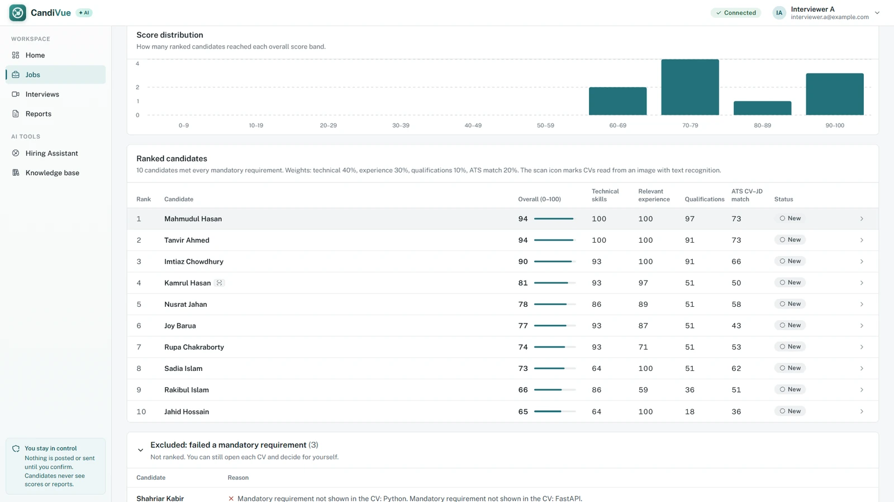

## Contents

- [Features](#features)
- [Screenshots](#screenshots)
- [Architecture](#architecture)
- [Tech stack](#tech-stack)
- [Installation](#installation)
- [Connecting the outside services](#connecting-the-outside-services)
- [Trying it out](#trying-it-out)
- [Configuration](#configuration)
- [Running the tests](#running-the-tests)
- [Project structure](#project-structure)
- [Security and privacy](#security-and-privacy)
- [Known limitations](#known-limitations)
- [Documentation](#documentation)
- [Author](#author)

## Features

| ID | Feature | What it does |
|---|---|---|
| | Hiring Assistant | A chat that builds the job profile, writes the job description from company documents, posts it to the job board after approval, builds the shortlist and schedules interviews (LangGraph 1). |
| | CV collection | Applicants apply through a Google Form; their CVs arrive in the app every few minutes. CVs can also be added by hand. |
| F1 | CV screening | Reads PDF and Word CVs (scanned ones by OCR), checks every requirement by meaning, not keywords, and excludes only on a missed must-have, with the reason shown (LangGraph 2). |
| F2 | Candidate scoring | A 0-100 score from skills, experience, qualifications and CV-job match. The weights can be changed; the same CV always gets the same score. |
| F3 | Video interview | One-to-one call in the browser with a waiting room, chat and screen sharing (self-hosted LiveKit). |
| F4 | Live transcript | Who said what and when, on screen during the call (Deepgram). Audio is never stored. |
| F5 | Answer analysis | Splits the interview into questions and answers and scores relevance, accuracy, completeness and articulation, checking facts against company documents (LangGraph 3). |
| F6 | Assessment report | Strengths, weaknesses, evidence gaps and points to verify, each citing its evidence. The interviewer approves it or asks for changes (LangGraph 4). |
| F7 | Identity check | With consent, the candidate's camera pictures are compared with the photo sent with the application. Only the interviewer sees the result. |
| F8 | CV claim check | Compares what the CV says with what the candidate said and suggests a follow-up question where they differ. |
| F9 | Interview score | A separate score for the interview on six dimensions, each with the answers it is based on. |
| F10 | Interview quality | Reviews the interview itself: requirements never asked about, weak questions, who did the talking. |
| F11 | Talent rediscovery | Past applicants who agreed to be considered again are checked against every new job and suggested to the interviewer (LangGraph 5). |
| | Final ranking and selection email | Candidates with an approved report are ranked; the interviewer picks who is selected and sends the email. |

## Screenshots

All data in the screenshots is made up. The face in the check-in and in the
call is a drawn silhouette.

| | |
|---|---|
| 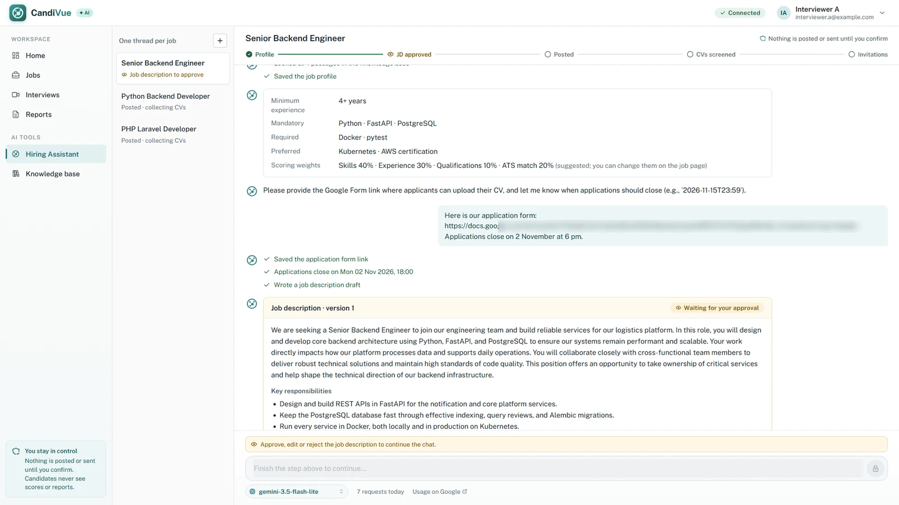 | 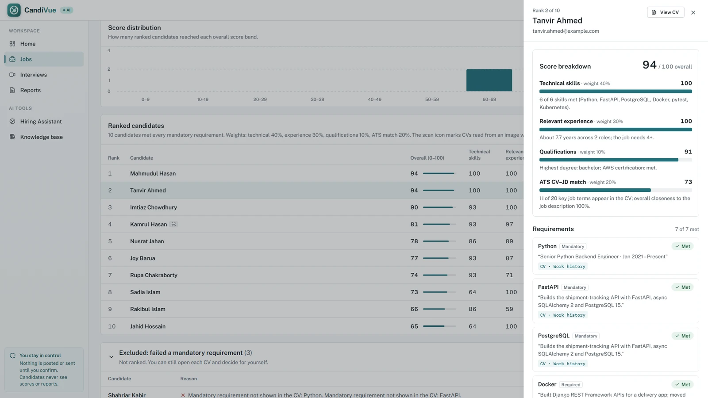 |
| **Hiring Assistant.** The job description waits for approval before anything is posted. | **Screening evidence.** Every requirement shows the CV line that met it. |
| 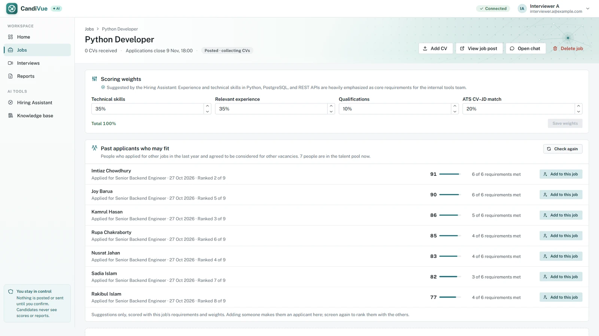 | 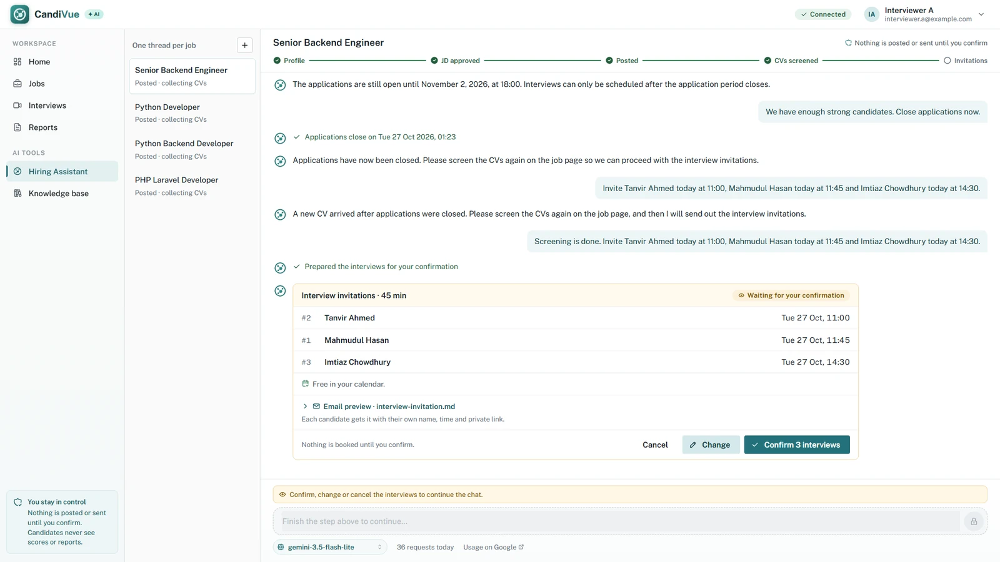 |
| **Talent rediscovery.** Past applicants who fit the new job. | **Invitations.** Times are checked against the calendar; nothing is sent before Confirm. |
| 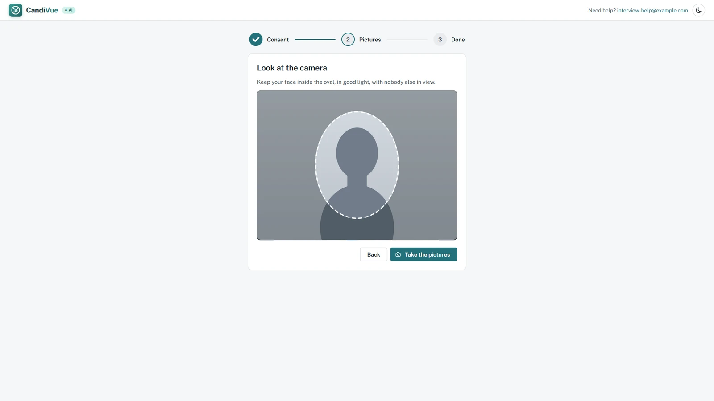 | 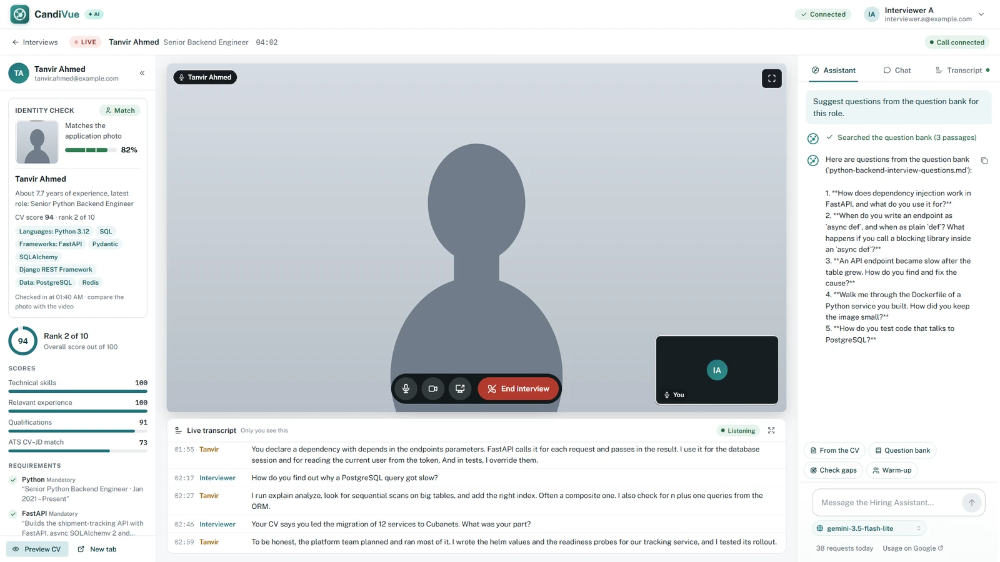 |
| **Check-in.** The candidate takes three pictures for the identity check. | **Interview room.** CV and identity result, the call, the live transcript and the assistant. |
| 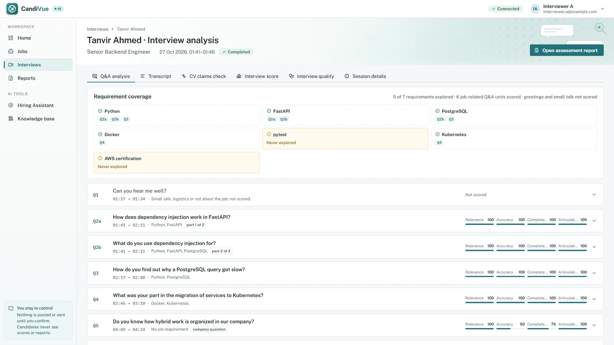 | 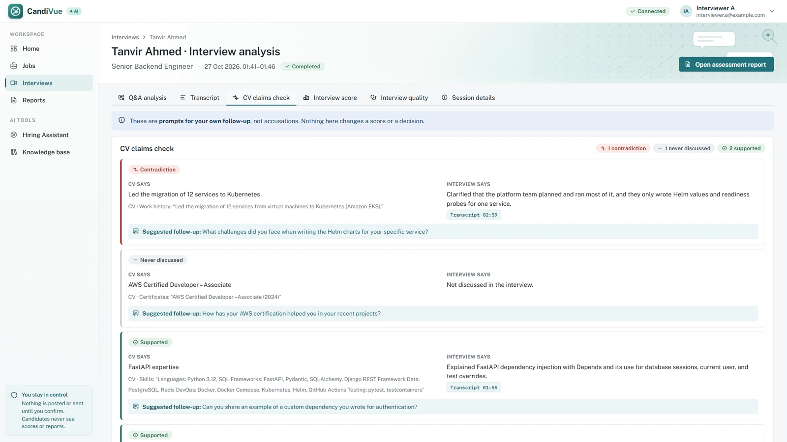 |
| **Answer analysis.** Scores per answer, and which requirements were explored. | **CV claim check.** Supported, contradicted or never discussed. |
| 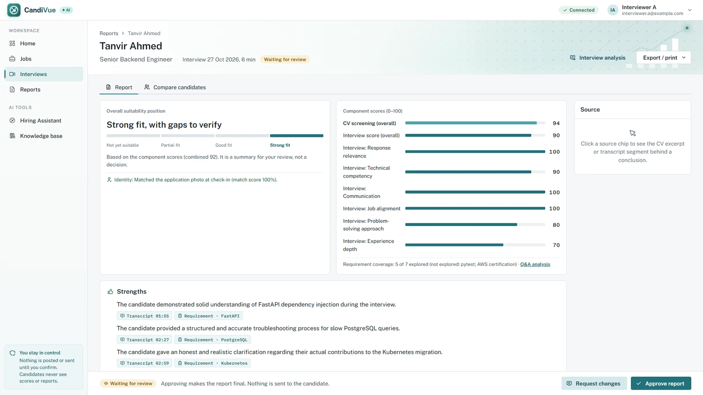 | 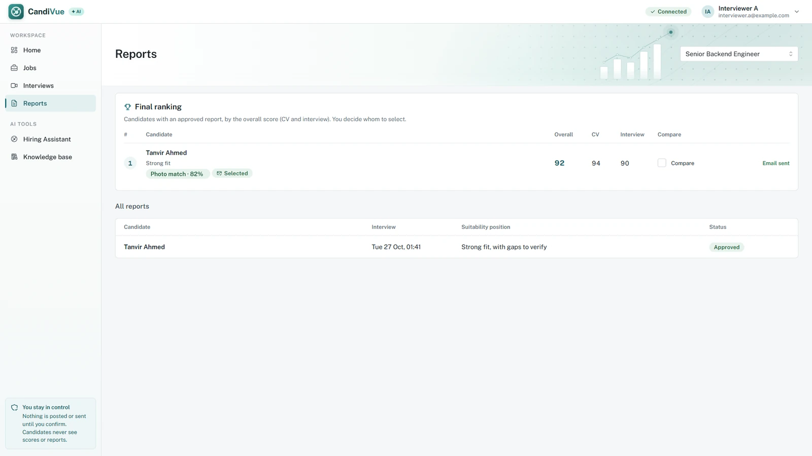 |
| **Assessment report.** Every point cites a CV item or a transcript line. | **Final ranking.** Only candidates with an approved report. |

More screens are in [`docs/screenshots/`](docs/screenshots/): knowledge base,
job post, interviews list, waiting room and interview quality.

## Architecture


The system runs as Docker Compose services on one machine:

- **frontend**: React app served by nginx. nginx also forwards `/api` to the
  backend and adds the security headers.
- **backend**: FastAPI with the five LangGraph workflows, the REST API
  (OpenAPI docs at `/docs`) and background runs.
- **db**: PostgreSQL 17 with pgvector. It holds the app data, the vector
  store for document search and the LangGraph checkpoints.
- **ollama**: local models for embeddings and the screening fallback.
- **jobboard-mcp, email-mcp, calendar-mcp**: three small MCP servers for
  Blogger, Gmail and Google Calendar. Each one is the only service that
  holds its own credentials.
- **cv-collector**: copies new CVs from the Google Form's Drive folder.
- **livekit** and **transcriber**: the video call and the live transcript.

| Workflow | Started by | Purpose |
|---|---|---|
| LangGraph 1, Hiring Assistant | The interviewer's chat | Tool-calling agent; pauses for approval before posting, inviting or moving interviews |
| LangGraph 2, CV Screening | "Screen CVs" button | Read, parse, check requirements, score and rank every CV |
| LangGraph 3, Q&A Analysis | Ending the interview | Split the transcript, score the answers, CV claims, interview score and quality |
| LangGraph 4, Final Assessment | End of LangGraph 3 | Write the cited report and wait for the interviewer's review |
| LangGraph 5, Talent Rediscovery | End of each screening | Screen the talent pool against the new job |

The detailed architecture (Figure 2) and one figure per LangGraph (Figures
3-7) are in [`docs/diagrams/`](docs/diagrams/) as PDF and PNG.

## Tech stack

| Area | Used |
|---|---|
| Backend | Python 3.13, FastAPI, Pydantic, SQLAlchemy, Alembic |
| AI workflows | LangGraph, LangChain |
| Models | Gemini 3.5 Flash-Lite (default); Ollama with qwen3-embedding:0.6b and qwen3:4b-instruct |
| Data | PostgreSQL 17, pgvector |
| Frontend | React 19, Mantine 9, React Router, Vite |
| Video and speech | LiveKit (self-hosted), Deepgram Nova-3 |
| Identity check and OCR | OpenCV YuNet and SFace, Tesseract |
| Integrations | MCP servers for Blogger, Gmail and Google Calendar; Google Drive and Sheets APIs |
| Infrastructure | Docker Compose, nginx |

## Installation

### Requirements

- Docker Desktop (Docker Engine with Compose v2), with about 15 GB of free
  disk space for the images, local models and volumes
- Git

Python and Node.js are only needed to run the tests outside Docker.

### Steps

1. Clone the repository.

   ```bash
   git clone <repository URL> candivue-ai-30225
   cd candivue-ai-30225
   ```

2. Create your `.env` from the template. It is git-ignored; never commit it.

   ```bash
   cp .env.example .env              # macOS, Linux, Git Bash
   Copy-Item .env.example .env       # Windows PowerShell
   ```

3. Fill in the required values in `.env`:

   | Setting | What to put |
   |---|---|
   | `POSTGRES_PASSWORD` | A password with letters and digits only |
   | `JWT_SECRET` | 32+ random characters: `python -c "import secrets; print(secrets.token_urlsafe(48))"` |
   | `DEMO_INTERVIEWER_PASSWORD` | Password of the first interviewer account (8+ characters) |
   | `LLM_API_KEY` | A Gemini API key from Google AI Studio |
   | `LIVEKIT_API_SECRET` | 32+ random characters, for the video calls |

4. Build and start everything.

   ```bash
   docker compose up --build -d
   ```

   The first start downloads the Ollama image and the local models (a few
   GB), so it takes several minutes once. Database migrations run on their
   own every time the backend starts.

5. Check that it runs.

   ```bash
   docker compose ps
   ```

   - App: <http://localhost:5173>
   - API docs (OpenAPI): <http://localhost:8000/docs>
   - Health check: <http://localhost:8000/api/health> returns
     `{"status":"ok","database":"ok"}`

6. Sign in at <http://localhost:5173> with `DEMO_INTERVIEWER_EMAIL`
   (default `interviewer.a@example.com`) and your
   `DEMO_INTERVIEWER_PASSWORD`. The header shows a green **Connected** badge.

### Everyday commands

| Task | Command |
|---|---|
| Start | `docker compose up -d` |
| Stop (keeps the data) | `docker compose down` |
| Backend logs | `docker compose logs -f backend` |
| Rebuild after a code change | `docker compose up --build -d` |
| Delete all data and start clean | `docker compose down -v` |

HTTPS on <https://localhost:5443> is optional: put a local certificate in
`certs/` (see [Transport security](docs/TECHNICAL_GUIDE.md#transport-security)).
A phone or a second computer needs HTTPS for the camera.

## Connecting the outside services

The app starts without these and says plainly what is not set up yet. Each
one needs its own keys in `.env`; the guide has the step-by-step setup.

| Service | Needed for | Settings in `.env` | Setup |
|---|---|---|---|
| Blogger | Posting approved jobs | `BLOGGER_*` | [Job board](docs/TECHNICAL_GUIDE.md#job-board-blogger) |
| Gmail (app password) | Access codes, invitations, selection email | `SMTP_USER`, `SMTP_PASSWORD`, `EMAIL_TEST_RECIPIENT` | [Email](docs/TECHNICAL_GUIDE.md#email-interview-invitations) |
| Google Calendar | Free times and interview events | `CALENDAR_*` | [Calendar](docs/TECHNICAL_GUIDE.md#calendar-google-calendar) |
| Google Form, Drive and Sheets | Receiving applications and CVs | `GOOGLE_SERVICE_ACCOUNT_KEY`, `CV_RESPONSES_SHEET_ID`, `GOOGLE_FORM_POSITION_FIELD` | [CV Collector](docs/TECHNICAL_GUIDE.md#cv-collector-google-drive) |
| Deepgram | Live transcript | `DEEPGRAM_API_KEY` | [Live transcript](docs/TECHNICAL_GUIDE.md#live-transcript-speech-to-text-f4) |
| Identity check | Photo check at check-in | `FACE_REFERENCE_KEY` | [Identity check](docs/TECHNICAL_GUIDE.md#identity-check-f7-and-the-candidate-access-code) |

The Blogger and Calendar sign-ins use a Google consent screen in testing
mode, so their refresh tokens end after 7 days. Renew them before a demo.

Keep `EMAIL_TEST_RECIPIENT` set to your own address while testing: every
email then goes to you instead of the (made-up) candidates.

## Trying it out

The repository has everything needed for a full run with made-up data:

- `test-data/synthetic-cvs/`: 29 synthetic CVs for a "PHP Laravel
  Developer" job, with an answer key in `EXPECTED.md`
- `test-data/knowledge-base/`: company policies, a reference library, an
  interview question bank and email templates

A typical run:

1. **Knowledge base:** upload the documents from `test-data/knowledge-base/`.
2. **Hiring Assistant:** describe the job in the chat, approve the job
   description and post it.
3. **Add CVs:** on the job page, add the synthetic CVs (or let the CV
   Collector bring them in from the form), then click **Screen CVs**.
4. **Shortlist and invite:** ask the assistant for a shortlist and
   interview times, then confirm on the card.
5. **Interview:** open the candidate's link from the email in a second
   window of the same browser, check in, and let the candidate in from
   the interviewer's tab.
6. **Report:** end the interview. The analysis and the report are ready in
   about a minute; review and approve the report.
7. **Decide:** on the Reports page, compare candidates and send the
   selection email.

For the talent-pool demo (synthetic CV 29) see
[Talent rediscovery](docs/TECHNICAL_GUIDE.md#innovation-feature-f11-talent-rediscovery).

## Configuration

All settings are in `.env`; `.env.example` explains each one. The ones you
are most likely to change:

| Setting | Default | Meaning |
|---|---|---|
| `LLM_MODEL` | `gemini-3.5-flash-lite` | Model used until the interviewer picks another under the chat |
| `LLM_MODELS` | `gemini-3.5-flash,gemini-3.5-flash-lite,gemini-3.1-flash-lite` | Models the interviewer may choose from |
| `SCREENING_AI_MODEL` / `SCREENING_MODEL` | `gemini-3.5-flash-lite` / `qwen3:4b-instruct` | Screening AI checks: Gemini first, the local model as fallback |
| `EMBEDDING_MODEL` | `qwen3-embedding:0.6b` | Local embedding model for document search |
| `FACE_RETENTION_DAYS` | `30` | Days face data is kept after the last interview |
| `REDISCOVERY_MAX_AGE_DAYS` | `365` | How long a past application stays in the talent pool |
| `ACCESS_TOKEN_MINUTES` | `480` | How long an interviewer stays signed in |
| `FRONTEND_PORT` / `BACKEND_PORT` | `5173` / `8000` | Local ports (change `CORS_ORIGINS` with the frontend port) |

## Running the tests

451 automated tests: 371 for the backend, 27 for the three MCP servers and 53
for the frontend.

```bash
docker compose run --rm --build tests            # backend, against the real database
docker compose run --rm --build jobboard-tests   # Blogger MCP (fake Blogger)
docker compose run --rm --build email-tests      # email MCP (fake SMTP server)
docker compose run --rm --build calendar-tests   # calendar MCP (fake Google Calendar)
```

Frontend (Node.js 22.22 or later):

```bash
cd frontend
npm install
npm test
```

Manual checks for the edge cases are listed in `test-data/TESTING.md`;
performance and security checks are in `docs/VERIFICATION.md`.

## Project structure

```text
candivue-ai-30225/
├── backend/            FastAPI app, LangGraph workflows, migrations, tests
│   └── app/
│       ├── graphs/     the five LangGraph workflows
│       ├── assistant/  Hiring Assistant tools, prompts and scope guardrail
│       ├── screening/  CV parsing, matching, scoring, AI checks
│       ├── analysis/   Q&A analysis and report prompts and scoring
│       ├── identity/   face check and photo handling
│       ├── collector/  CV Collector (Google Drive and Sheets)
│       ├── transcriber/ live transcript (LiveKit to Deepgram)
│       └── api/        REST routes
├── frontend/           React app and nginx configuration
├── jobboard-mcp/       MCP server for Blogger
├── email-mcp/          MCP server for Gmail
├── calendar-mcp/       MCP server for Google Calendar
├── docs/               requirements, technical guide, diagrams, screenshots
├── test-data/          synthetic CVs, knowledge-base documents, test notes
├── infra/              database start-up script
└── docker-compose.yml
```

## Security and privacy

- **Roles are checked in the backend.** Every API route needs the
  interviewer role unless it is on a short candidate list; a test fails if
  a new route forgets the check. Candidates get `403` for scores, rankings,
  transcripts and reports.
- **Candidates sign in per interview.** Private link plus a 6-digit code sent
  to their email: one use, 10 minutes, 5 tries, stored only as an HMAC.
- **Interviewer accounts:** Argon2 password hashes, signed JWT tokens that
  expire after 8 hours.
- **Secrets** only in `.env`. Every package and image version is pinned.
  The backend and MCP containers run as a non-root user.
- **nginx** sends a strict Content-Security-Policy, HSTS (with HTTPS),
  X-Frame-Options, Referrer-Policy and a Permissions-Policy that allows the
  camera and microphone for the app only.
- **AI safety:** documents, CVs and transcripts are passed to the model as
  data, never as instructions. The Hiring Assistant declines anything
  outside hiring. Every AI output has a fixed shape that is checked in
  code, and nothing is posted, sent or final until the interviewer
  approves it.

### Data sent to outside services

| Service | What it receives |
|---|---|
| Google Gemini | Job data and chat; CV text and interview transcripts with names, emails, phone numbers and links removed |
| Deepgram | Interview audio, streamed during the call, with the opt-out from model training set. CandiVue never stores audio. |
| Gmail | Candidate email address, name, job title, interview time, private link and the one-time access code |
| Google Calendar | The interviewer's interview events: candidate name, job title, time. No email addresses, no guests. |
| Blogger | The approved job description. No candidate data. |
| Google Forms, Drive, Sheets | What applicants submit through the form; the CV Collector only reads it |

Embeddings, the screening fallback model, face recognition and OCR run on
the local machine.

On Gemini's free tier, Google may use the data it receives to improve its
products. Use a free key with synthetic data only, never with real
candidates.

### Face data (identity check)

- Asked for with explicit consent in the application form and again at
  check-in; skipping has no effect on the interview.
- Only an encrypted face embedding and an encrypted 320 px face crop are
  kept, never the original photo. Check-in pictures are compared in memory
  and dropped.
- Deleted 30 days after the applicant's last interview
  (`FACE_RETENTION_DAYS`), when the candidate withdraws, or when the
  candidate or the job is deleted.
- The original photo stays in the form owner's Google Drive; delete it
  there after the job.

### Deleting data

Deleting a candidate (`DELETE /api/jobs/{job}/cvs/{candidate}`) removes the
application, CV file, scores, interviews, transcripts, reports, face data
and saved workflow state in one request. Deleting a job does the same for
all its applicants and also removes the job post.

### Local development exceptions

Plain HTTP is used only on `127.0.0.1` (the app on port 5173 and the API docs
on port 8000), so nothing is reachable from another machine. Use HTTPS for
anything beyond that.

The full privacy note, the transport table and the secure-by-design notes
are in the [technical guide](docs/TECHNICAL_GUIDE.md#privacy-note).

## Known limitations

- **Single machine.** Background runs execute inside the backend container,
  two at a time. That is enough for the local setup this project needs.
- **Sign-in.** No limit on login attempts and no second factor for
  interviewers yet; a signed-out token stays valid until it expires.
- **English only.** The CV rules, OCR and transcript are set up for English.
- **Screening.** Similarity thresholds were tuned on synthetic CVs, and
  years of experience count the whole career, not years per skill.
- **Identity check.** It shows that the person matches the photo the
  applicant sent. It is not an ID-document check and does not detect a
  live face swap. Face models can be less accurate for some groups and in
  poor light, so the result never changes a score.
- **Speech recognition** can mishear accents and technical words; the
  analysis prompts treat an odd word as a probable recognition error.
- **Google tokens.** The Blogger and Calendar refresh tokens end after 7
  days while the consent screen is in testing mode.
- **Fairness.** Only job-related data is scored. Age, gender, ethnicity,
  nationality, religion and marital status are never stored or used, and
  every AI prompt says so. The AI can still be wrong, which is why every
  conclusion shows its evidence and a person makes the decision.

## Documentation

| Document | Contents |
|---|---|
| [docs/TECHNICAL_GUIDE.md](docs/TECHNICAL_GUIDE.md) | How each part works, setup of every outside service, measured results |
| [docs/requirement.md](docs/requirement.md) | Requirements and project decisions |
| [docs/VERIFICATION.md](docs/VERIFICATION.md) | Security, privacy and performance checks |
| [docs/diagrams/](docs/diagrams/) | Architecture diagram and the five LangGraph figures (PDF and PNG) |
| [docs/design_handoff_candivue_ui/](docs/design_handoff_candivue_ui/README.md) | UI design used for the frontend |
| [test-data/TESTING.md](test-data/TESTING.md) | Test data and manual edge-case checks |

## Author

Miftahul Islam (ID 30225), AI Trainee, BJIT Academy.
B.Sc. in Computer Science and Engineering, Chittagong University of
Engineering and Technology (CUET).
